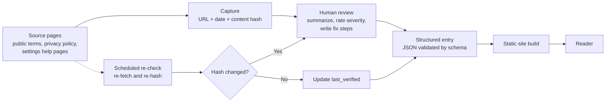

# Concept: Plain-English Terms & Privacy Guide

> **Status:** concept model only. No app code yet.
> **Information, not legal advice.** See [legal-and-safety.md](legal-and-safety.md).

## The problem

People sign up for AI services and install apps without knowing what they agreed to. Terms of service and privacy policies are long and written in legal language. The settings that protect you are often buried, and many are **on by default** until you find and switch them off.

## Users

- **Everyday users** of AI chatbots, assistants and image tools who want to know "what did I just agree to, and what should I change?"
- **Parents and households** choosing tools for others.
- **Small teams** that want a quick privacy-first setup before rolling a tool out.

## Value

For each service, one vetted page that answers five questions:

1. **What you agree to.** The key terms, in plain words.
2. **What you can refuse.** The optional parts.
3. **The gotchas.** Things that happen by default (training on your chats, data sharing, retention, location or contacts access).
4. **How to fix it.** Exact steps, e.g. "Settings > Privacy > turn off X if you don't want this."
5. **Recommended setup.** A privacy-first configuration, with a note on when leaving a setting on is a reasonable choice.

The focus is the reader, not the company.

## Scope by phase

| Phase | Covers | Notes |
|-------|--------|-------|
| 1 | AI services: chatbots, assistants, image tools | Start small, with a handful of well-reviewed pages. |
| 2 | Popular app-store apps | Same entry format, new categories. |
| Later | Anything with click-through terms | Only if phases 1 and 2 work. |

**Out of scope for v1:** reading anyone's accounts or data, user logins, or any app that touches personal data. v1 reads **public** terms and policy pages only.

## How "write once, read many" works

Each service gets **one** curated entry, written and reviewed by a person. The site is built from those entries into plain static pages. Nothing is generated per visitor, so every reader sees the same vetted answer. Hosting is cheap and fast, and there is no user data to protect because there are no accounts.

Every claim in an entry points back to a **source**: the official page URL, the date it was captured, and a **content hash** of the captured text. If the hash of a re-fetched page differs from the stored one, the terms changed and the entry goes back to review. Details are in [data-model.md](data-model.md).

### The re-check loop

On a schedule (cadence is an open question, see [roadmap.md](roadmap.md)) each source is fetched again and hashed. **Same hash:** the terms did not change, so only `last_verified` is updated. **Different hash:** the entry is flagged, a person reviews the difference, updates the entry, and adds a line to its `change_log`. Each page shows its "last verified" date so readers can judge freshness.

## Ways it could make money (to decide later)

- A **paid guide** (e.g. a bundled "privacy setup" guide per category).
- A **browser extension** that surfaces the page for the service you are on.
- A **subscription for alerts** when a service's terms change (the re-check loop already produces this signal).

Free pages stay free in all of these. Any paid offer should have a lawyer's review first (see [legal-and-safety.md](legal-and-safety.md)).
